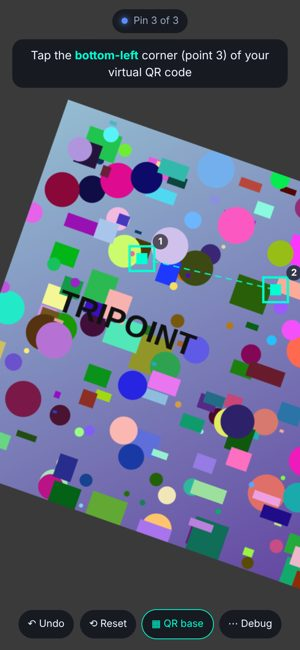
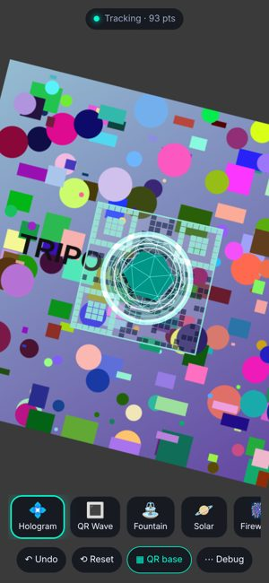
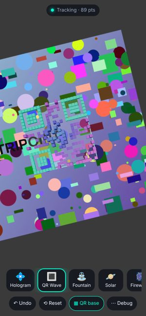

# TriPoint AR

A mobile web app that turns **three points you tap on the live camera image** into a
**virtual QR code** and plays AR animations anchored on it.

A real QR code is located by its three finder patterns (top-left, top-right, bottom-left).
TriPoint AR uses the same idea, but you place the three "finder patterns" by tapping them on
any flat, textured surface. The app tracks that patch of the scene in real time, recovers the
camera pose relative to it, and renders 3D animations standing on the virtual code.

| Pin 3 points | Locked: virtual QR + Hologram | QR Wave |
| --- | --- | --- |
|  |  |  |

<sub>Screenshots from the automated browser test, which uses a synthetic camera.</sub>

## Using it

1. Open the app on your phone (it must be served over **HTTPS**; see below) and tap **Start camera**.
2. Aim at something flat with some texture: a poster, a book cover, a magazine, a patterned rug.
3. Tap the **top-left**, **top-right** and **bottom-left** corners of where the virtual code should be.
   Each tap snaps to the strongest nearby corner, so it can be tracked. Pins you already placed stay
   glued to the scene while you aim for the next one.
4. When the third pin goes down, the virtual QR code locks on and an animation appears. Pick another
   one from the bar at the bottom: **Hologram, QR Wave, Fountain, Solar, Fireworks**.
5. Move around: the content stays put. If you look away, the status turns red ("Target lost").
   Point back at the spot and it is found again automatically. **Reset** starts over, **Undo**
   removes the last pin, **QR base** toggles the virtual code overlay, **Debug** shows tracked points.

No camera available (desktop, embedded preview)? The start screen also offers **Record or pick a
video**, which tracks a clip you film with your phone, and **Try the demo scene**, a synthetic camera
filming a poster.

Tips: pin points that are clearly distinguishable (corners of letters or shapes, not plain areas),
spread them out, and keep the surface reasonably well lit.

## How it works

Everything runs in the browser. There is no server and no AR framework, just `getUserMedia`,
a small computer-vision pipeline in TypeScript, and Three.js for rendering.

```
camera frame ─► downscale to ≤480px, grayscale ─► Gaussian pyramid (+ gradients)
                                                     │
      pinning:  tap ─► snap to Shi-Tomasi corner      │  LK keeps placed pins on the scene
                                                     ▼
      tracking: pyramidal Lucas-Kanade on ~90 corners around the code
                (forward-backward + NCC checks)
                ─► RANSAC homography: code (unit square) ─► image
                ─► One-Euro smoothing of the 4 projected corners
                ─► homography decomposition with estimated intrinsics ─► camera pose
                ─► Three.js camera/anchor ─► animations
```

* **Marker definition** (`src/vision/tracker.ts`): the pins define a coordinate frame where
  P1 = (0,0), P2 = (1,0), P3 = (0,1), so the fourth corner (1,1) is implied, as in a QR code.
  Pins placed counter-clockwise are swapped (the finder layout is symmetric about the diagonal),
  so content always stands on top of the surface.
* **Robust planar tracking**: tracking only the three pinned pixels would be fragile, so the
  tracker follows every good corner in and around the code area, then fits the
  marker → image homography with RANSAC every frame and re-projects the pins through it. Lost
  features are replenished. Fewer than 8 features falls back to an affine model.
* **Losing and recovering the target**: a frame fails when the fit is implausible or loses most of
  its support (an abrupt cut, an occlusion). While failing, points are matched against the last
  good frame rather than the previous one, so the tracker never latches onto unrelated content.
  After a few failed frames the target is *lost*, and a coarse-to-fine NCC template search for the
  three pins runs over the whole frame. It uses both the lock-time appearance and a recent view.
* **Pose** (`src/ar/pose.ts`): `H ~ K [r1 r2 t]` is decomposed with an assumed ~67° field of view
  across the long side (typical for phone main cameras) and orthonormalized. The Three.js camera
  uses the same intrinsics, and the WebGL canvas covers exactly the video frame, so the content
  lines up with the pins.

```
src/
  main.ts            UI state machine, frame loop, layout, tapping
  camera.ts          getUserMedia + frame grabbing
  vision/
    image.ts         grayscale, pyramids, gradients, bilinear sampling
    features.ts      Shi-Tomasi corners, tap snapping
    lk.ts            pyramidal Lucas-Kanade (forward-backward + NCC verification)
    homography.ts    normalized DLT, affine fit, RANSAC, helpers
    ncc.ts           template matching for relocalization
    tracker.ts       the virtual-QR planar tracker
  ar/
    pose.ts          intrinsics estimate, homography -> pose
    filter.ts        One-Euro filter
    scene.ts         Three.js renderer, anchor, virtual QR base, scan effect
    animations.ts    Hologram, QR Wave, Fountain, Solar, Fireworks
    textures.ts      procedural textures (QR pattern, glow, shadow)
```

## Development

```bash
npm install
npm run dev        # HTTPS dev server on your LAN (self-signed cert) -> open https://<your-ip>:5173 on the phone
npm test           # unit tests: homography, LK, tracker on synthetic sequences, pose, filter
npm run build      # production build in dist/
npm run e2e        # browser test with a synthetic camera (needs `npm run build` and Playwright's Chromium)
```

The phone must accept the self-signed certificate warning on first visit. Camera access only
works in a secure context: `https://` or `http://localhost`.

### Deploying

`.github/workflows/deploy.yml` runs the type check, tests and build on every push, and on
`main` publishes `dist/` to **GitHub Pages**. Enable it once under *Settings → Pages → Source:
GitHub Actions*. The resulting `https://<user>.github.io/<repo>/` URL works directly on phones.
Pages deploys from the repository's default branch, and private repositories need a GitHub
plan that includes Pages. Any static HTTPS host also works (the build uses relative paths).

`npm run build:artifact` packs the build into a single HTML body (`dist-artifact/tripoint-ar.html`)
for hosts that take one file, such as a claude.ai artifact. Live camera access is blocked in that
sandbox, so use the video or demo sources there.

### End-to-end test

`e2e/fake-camera.js` replaces `getUserMedia` with a synthetic camera filming a moving poster,
and exposes the ground truth. `e2e/run.mjs` taps three points, moves the camera through every
animation, and checks that the tracked pins stay within ~3 px (at processing resolution) of
where they really are. It then looks away to a different scene and back, checking that the
target is reported lost and relocalized. Screenshots are written to `test-output/`.

## Limitations

* The surface must be roughly planar and textured. Plain white walls cannot be tracked.
* The focal length is estimated, not calibrated. Poses are visually consistent but not metric.
* At lock time the code's shape is taken as seen (affine), so taps on a strongly slanted surface
  give a slightly skewed virtual code.
* Relocalization works best when you come back to a similar viewpoint as where tracking was lost.
