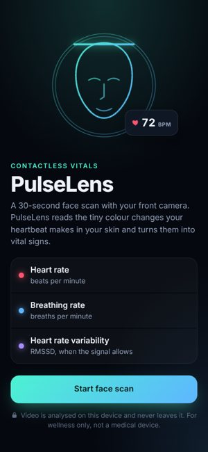
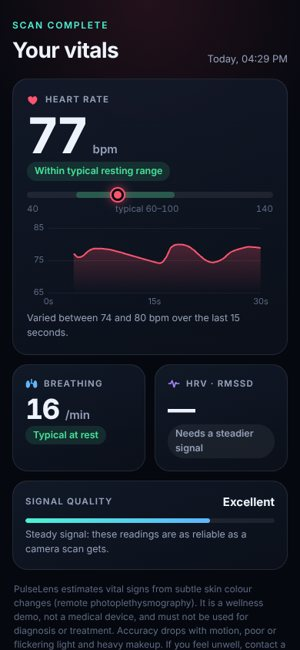

# PulseLens

An AR health check in the browser. PulseLens scans your face with the phone's **front camera**
for 30 seconds and measures **heart rate**, **breathing rate** and, when the signal allows,
**heart rate variability (HRV)**. The readings float beside your face in an AR overlay while a
face-mesh scan animation runs. The results add three simple wellness insights: **stress**,
**sleep** (tiredness) and **sport** (training zone, recovery, resting fitness).

| Start | Results |
| --- | --- |
|  |  |

<sub>Screenshots from the automated test, which uses a synthetic camera with a simulated 78 bpm pulse.</sub>

> **Not a medical device.** PulseLens is a wellness demo. Its estimates must not be used for
> diagnosis or treatment.

## How it works

With every heartbeat, the blood volume in the skin's capillaries changes a little, which changes
how much light the skin absorbs, mostly in green. A camera can see this as a colour change of
well under 1%. Recovering a pulse from it is called **remote photoplethysmography (rPPG)**.

```
front camera ─► MediaPipe Face Landmarker (478-point face mesh, on-device)
                 │
                 ├─► measurement regions: forehead + both cheeks (convex hulls of mesh points)
                 │     └─► mean skin colour per frame (over-exposed and very dark pixels skipped)
                 │           └─► resample to 30 Hz ─► POS algorithm ─► band-pass 0.65–3.5 Hz
                 │                 ─► remove head-motion artefacts (regression on head pose)
                 │                 ├─► spectrum peak (+ SNR) ─► heart rate, signal quality
                 │                 └─► steepest upstroke of each beat ─► beat times ─► HRV (RMSSD)
                 ├─► head motion + slow colour baseline ─► band-pass 0.1–0.6 Hz ─► breathing rate
                 └─► face size, position, angle, motion, light ─► live guidance
```

* **Face tracking** (`src/face/`): MediaPipe Face Landmarker runs on the GPU, falling back to the
  CPU, with the runtime and model self-hosted. It gives a 478-point mesh and the head angle.
* **Regions** (`src/face/regions.ts`): the forehead (including the glabella) and both cheeks.
  Studies consistently find these give the strongest, steadiest rPPG signal: they are flat,
  well lit and have little muscle movement. Eyes, brows, lips and hair are excluded.
* **Pulse extraction** (`src/rppg/pos.ts`): POS, "Plane-Orthogonal-to-Skin" (Wang, den Brinker,
  Stuijk & de Haan, IEEE TBME 2017). Colour is normalised over 1.6 s windows and projected onto
  a plane orthogonal to the skin tone, which cancels most brightness and specular changes from
  motion and lighting. In benchmarks, POS and CHROM are among the most robust classic methods.
* **Heart rate** (`src/rppg/estimator.ts`, `dsp.ts`): zero-phase Butterworth band-pass, Hann-
  windowed FFT over a 10 s window, and a parabolic peak. A spiky pulse wave can have a second
  harmonic stronger than its fundamental; the estimate only moves down to half the peak frequency
  when the spectrum also shows the third harmonic, so a fast post-exercise pulse is not halved
  by noise near half its rate. The signal-to-noise ratio (de Haan's definition) becomes a
  confidence score, and each new estimate is smoothed in proportion to its quality. When five
  consecutive estimates agree on a clearly different rate, the reading re-locks to it at once.
* **Motion artefacts** (`src/rppg/motion.ts`): heavy breathing after exercise rocks the head,
  and the light on the skin changes with it at the breathing rate and its harmonics. POS can't
  remove this when it looks like a blood volume change, and it can outweigh the pulse: breathing
  at 32/min then reads as a 64 bpm "pulse". The face tracker's head pose (position, size, yaw,
  pitch, roll), its squares and, for large motion, its cubes are band-passed like the pulse and
  regressed out of it. References that only show tracking jitter are left out, so a still head
  is unaffected.
* **HRV** is only reported when the pulse SNR is at least 5 dB. Tests show that below that,
  beat-timing noise roughly doubles RMSSD, so the app says "needs a steadier signal" instead of
  showing a wrong number.
* **Breathing** comes from the slight up-and-down head motion and the slow colour baseline
  (respiratory-induced intensity variation), whichever has the cleaner spectrum.
* **Guidance and safety nets** (`src/scan.ts`): the scan only starts once the face is centred,
  close enough, facing the camera, still and well lit. During the scan, losing the face pauses
  it, and other problems lower the quality score and show a hint. If the analysed frame rate
  falls below 5 fps (where a pulse would alias to a wrong rate), measuring pauses. Between 5 and
  8 fps the heart-rate search is limited to what that rate can represent.
* **AR layer** (`src/ui/fx.ts`): a canvas over the mirrored video draws the alignment dial, the
  face mesh with a sweeping scan band, the face contour, lock-on brackets, a segmented progress
  ring around the face, and measurement regions that glow with each heartbeat. Glass metric cards
  ride beside the face with leader lines to it. A **performance governor** drops the glass blur
  and mesh detail, then animation rate, on slow devices, so measurement always gets the CPU
  first.

### Wellness insights

The results screen shows three tiles; tapping one opens a sheet with the reading, a gauge, the
measurements behind it and a tip (`src/insights/`, `src/ui/insights.ts`). An **At rest / Just
exercised** switch sets the context. It is detected from the heart rate (raised, or clearly
falling during the scan), and the person can correct it: a pulse of 91 after the gym is neither
stress nor low fitness.

* **Stress**: under stress the heart and breathing speed up and the beat-to-beat rhythm becomes
  more regular. The score weights HRV (RMSSD) most when it was measured, plus heart rate and
  breathing; without HRV it is labelled a rough estimate and leans on breathing, since a raised
  pulse alone has many causes. Right after exercise it asks you to
  rest first rather than reading the workout as stress.
* **Sleep**: a camera can't see how you slept, but tiredness shows in the eyes. MediaPipe's
  eye-blink blendshapes give blink rate, blink length (time more than half closed), PERCLOS (the
  share of time the eyes are at least 80% closed, the standard drowsiness measure in driver
  monitoring), long closures and yawns. Thresholds adapt to each person's open-eye level.
* **Sport**: a scan right after a workout (raised or clearly falling heart rate) shows the
  training zone (needs your age, kept on the phone; max heart rate 208 − 0.7 × age, Tanaka 2001)
  and how fast the heart rate is falling during the scan, a well-known fitness sign. The slope is
  a median of pairwise slopes, checked against the first and last thirds, so a glitch can't fake
  a fast recovery. At rest it rates fitness from the resting heart rate.

### Camera and frame rate

The app asks for a 960×720 front-camera stream at 30 fps with a floor of 24 fps: in dim light
phone cameras otherwise halve their frame rate for longer exposures, and the pulse needs frames
more than pixels. Skin sampling copies only the face's bounding box from each frame. Below
~14 fps the scan shows a hint to find more light, and the results and copied summary report the
frame rate.

### Privacy

Everything runs in the browser. Video frames are analysed on the device and never uploaded. The
face model, the MediaPipe runtime and the font are served with the app, so it makes no
third-party requests.

### Accuracy and limitations

* Motion, poor or flickering light (some LED and fluorescent lamps), strong backlight, heavy
  makeup and auto-exposure changes all reduce accuracy. The quality score reflects this.
* Published camera-based heart-rate errors are typically a few bpm at rest under good
  conditions, and much worse with motion. HRV is more fragile than heart rate. Breathing estimates
  assume you sit still and breathe normally.
* The reference ranges shown are general adult resting ranges, not personal advice.

### Research consulted

* Wang et al., *Algorithmic Principles of Remote PPG* (POS), IEEE TBME 2017; comparisons in
  [rPPG in the wild via online webcams](https://www.ncbi.nlm.nih.gov/pmc/articles/PMC11362249/),
  [Frontiers in Physiology 2023](https://www.frontiersin.org/journals/physiology/articles/10.3389/fphys.2023.1296277/pdf),
  [Diverse R-PPG](https://arxiv.org/pdf/2010.12769).
* Region choice: [Po et al., ICASSP 2015](https://www.ee.cityu.edu.hk/~lmpo/publications/2015_ICASSP_rPPG.pdf),
  [ROI review (PMC8659899)](https://pmc.ncbi.nlm.nih.gov/articles/PMC8659899),
  [facial surface orientation, CVPRW 2022](https://mlanthology.org/cvprw/2022/wong2022cvprw-optimising).
* Breathing and HRV from cameras: [front-camera respiratory rate (medRxiv)](https://www.medrxiv.org/content/medrxiv/early/2021/03/12/2021.03.08.21252408.full.pdf),
  [contactless HRV with a smartphone](https://pure.skku.edu/en/publications/contactless-heart-rate-variability-hrv-estimation-using-a-smartph/).
* [MediaPipe Face Landmarker for Web](https://developers.google.com/edge/mediapipe/solutions/vision/face_landmarker/web_js).

## Development

```bash
npm install
npm run dev        # HTTPS dev server on your LAN (self-signed cert): open https://<your-ip>:5173 on the phone
npm test           # signal-processing tests on simulated skin-colour signals
npm run build      # production build in dist/ (copies the MediaPipe runtime into dist/mediapipe)
npm run e2e        # browser test with a synthetic front camera (after npm run build)
```

The camera needs a secure context (`https://` or `http://localhost`). `?delegate=cpu` forces
MediaPipe's CPU path (used by the headless test, whose GPU is emulated). `?debug` shows a
diagnostics panel during the scan: frame rate, raw and smoothed heart rate, SNR, head-motion
compensation and breathing.

The intro screen shows the build (commit and date). The build also publishes `version.json`;
when it names a newer build than the one running, the app reloads itself between scans, since
phones keep tabs open and GitHub Pages lets browsers cache the page.

### Tests

* `tests/eyes.test.ts`: blink rate and length, drooping lids, yawns, long closures, a raised
  open-eye level, and the closed-eyes and slow-camera flags. `tests/insights.test.ts`: the
  stress, sleep and sport assessments, after-exercise detection and the recovery slope.

* `tests/rppg.test.ts` simulates the mean skin colour of a face: a realistic pulse wave with
  beat-to-beat variability, breathing, lighting flicker, noise and jittery frame timing. It checks
  heart rate at 55–125 bpm (within 2.5 bpm), a fast heart rate falling after exercise
  (150→136, 132→118, 112→104 bpm) with breathing and motion noise near half the rate, recovery
  from a noisy start, heavy breathing that rocks the head (125 bpm through 32 breaths/min, which
  reads as 64 bpm without motion compensation), resting readings with a drifting hand-held
  camera, that pure brightness flicker is not mistaken for a pulse, HRV against the true beat intervals, the HRV quality gate and the breathing rate.
* `e2e/run.mjs` runs the built app in Chromium with `e2e/fake-front-camera.js`, a synthetic front
  camera filming a rendered head whose skin pulses at a known rate (default 78 bpm, `BPM=90` to
  change), with natural sway and breathing motion. It checks the no-face guidance, alignment,
  live readings, the final heart rate (±5 bpm) and the results screen. In this environment the
  result was 77–80 bpm and breathing 15.0/min against 15 simulated.

  This headless browser only manages about 7 camera frames per second. That is enough for resting
  rates but not for fast ones: in simulation, heart rates up to ~125 bpm need at least ~10 fps,
  150 bpm about 12 fps and 175 bpm about 20 fps (phones usually run at 20–30 fps). Fast,
  post-exercise rates are therefore covered by the unit tests rather than this test.

### Deploying

`.github/workflows/deploy.yml` type-checks, tests and builds on every push, and publishes `dist/`
to GitHub Pages from the default branch.

## Credits

* [MediaPipe](https://github.com/google-ai-edge/mediapipe) Face Landmarker runtime and model,
  Google, Apache 2.0 (see `public/models/README.md`).
* [Inter](https://rsms.me/inter/) typeface by Rasmus Andersson, SIL Open Font License, via
  Fontsource.
* Test fixture: rendering of the Lee Perry-Smith head scan by Infinite-Realities, CC BY 3.0
  (see `e2e/fixtures/README.md`). It is used only by the automated tests.
