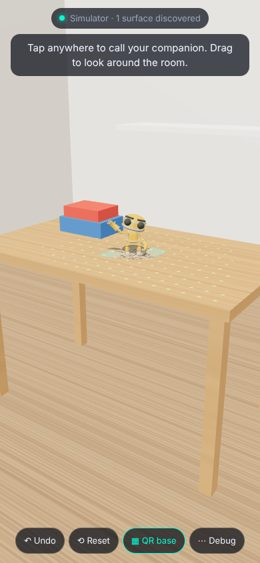
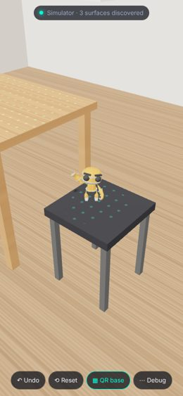
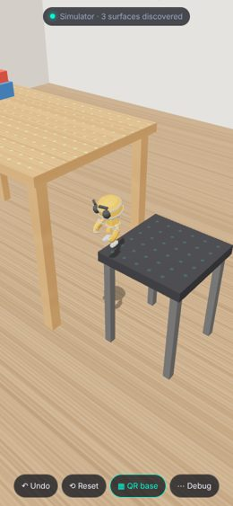
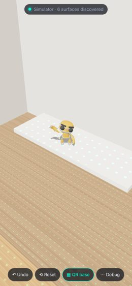

# TriPoint AR

A mobile web app with a **3D AR companion**. Tap three corners of a square on a surface to place a
**virtual QR code**, and a little robot appears on it. It wanders around, notices other surfaces
as your camera finds them (a chair, a shelf, the floor) and jumps over to explore them. Tap any
surface and it finds a way there, walking and jumping from surface to surface, and waves at you.

A real QR code is located by its three finder patterns (top-left, top-right, bottom-left).
TriPoint AR uses the same idea, but you place the three "finder patterns" by tapping them on a
real surface.

| Appears on the code | Explores a stool | Jumps to the floor | Climbs onto a shelf |
| --- | --- | --- | --- |
|  |  |  |  |

<sub>Screenshots from the automated simulator test (a virtual room; see below).</sub>

## Two tracking modes

* **WebXR (Android Chrome with ARCore, and other WebXR AR browsers).** When the phone supports it,
  the app starts in **Start AR** mode. The phone's own AR system tracks the camera in 3D and finds
  real surfaces, the same approach as three.js's `webxr_ar_hittest` example. Each tap is
  hit-tested against the actual surface, so the three pins are true 3D points. The virtual QR code
  is built from them in world space and held by an XRAnchor. This is the most stable mode.
  The companion maps surfaces with a fan of hit-test rays and, where the browser offers it, plane
  detection, so it can travel between all the surfaces the phone has seen.
* **Camera tracking (iPhone, and everything else).** Safari on iPhone has no WebXR AR, so the app
  runs its own vision tracker on the camera feed, described under *How it works*. It only knows
  the one surface the code is on, so there the companion walks to taps on that surface but can't
  discover others.
* **Simulator (any device).** **Try the simulator** opens a virtual room (table, books, stool,
  crate, shelf) with the same flow: place the code, look around by dragging, tap to call the
  companion. Its "AR system" casts rays from the virtual camera like WebXR hit-tests, so
  surfaces are discovered only once you have looked at them.

## Using it

1. Open the app on your phone (it must be served over **HTTPS**; see below) and tap **Start camera**.
2. Aim at something flat with some texture: a poster, a book cover, a magazine, a patterned rug.
3. Tap the **top-left**, **top-right** and **bottom-left** corners of a square lying on the surface,
   where the virtual code should be. The perspective of that square tells the app how the surface
   is tilted, so content stands up from it in 3D right away. Each pin is tracked from the strongest
   corner near your tap, and pins you already placed stay glued to the scene while you aim for the
   next one.
4. When the third pin goes down, the virtual QR code locks on and the companion appears and waves.
   Tap anywhere on a surface to call it there: it walks, runs or jumps its way over and waves.
   If it can't get there, it goes as close as it can and shakes its head.
5. Look around: each new surface the phone finds lights up with a dot grid when the companion
   first jumps onto it. Left alone, it wanders and explores reachable surfaces it hasn't been
   on yet.
6. Move around: the content stays put. Moving the phone sideways around the spot measures the
   surface's real 3D orientation from parallax (status shows "3D locked"), which also corrects taps
   that were not quite a square. If you look away, the status turns red ("Target lost").
   Point back at the spot and it is found again automatically. **Reset** starts over, **Undo**
   removes the last pin, **QR base** toggles the virtual code overlay, **Debug** shows tracked points, surface outlines
   and the companion's planned path.

No camera available (desktop, embedded preview)? The start screen also offers **Record or pick a
video**, which tracks a clip you film with your phone, and **Try the simulator**.

Tips: pin points that are clearly distinguishable (corners of letters or shapes, not plain areas),
spread them out, and keep the surface reasonably well lit.

## The companion

```
surface sensing (WebXR hit-test fan / plane detection / simulator rays)
   └─► SurfaceMap: horizontal hits grouped by height into convex outlines, merged when they meet
         └─► navigation: Dijkstra over surfaces; edges = possible jumps
               (gap to a neighbour, step off an edge onto a lower surface, jump up onto a higher one)
               └─► CompanionBrain: walk / turn / jump (real ballistic arc) / emote, explore, go to taps
                     └─► CompanionCharacter: rigged robot, cross-faded clips, head tracks the user
```

* **Surfaces** (`src/companion/surfaces.ts`): every hit on a horizontal surface joins the surface
  at the same height whose outline it is close to, or starts a new one. Surfaces need a few hits
  and some area before the companion trusts them, and a tap on a surface counts as strong
  evidence. Pieces at floor level (1 m below the phone) always merge into one floor.
* **Paths** (`src/companion/navigation.ts`): surfaces are graph nodes and possible jumps are edges,
  limited to what the companion can do relative to its height (up 4×, down 8×, across 4×). The
  route walks to a take-off point, jumps, and repeats until it reaches the goal. An unreachable
  goal gives a plan to the closest reachable point.
* **Behaviour** (`src/companion/brain.ts`): a small action queue (walk, turn, jump, idle, emote).
  Jumps follow a real parabola under real gravity at the scene's scale. Walking speed matches the
  walk cycle so the feet don't slide. Idle time is spent wandering, emoting or exploring the
  nearest reachable undiscovered surface.
* **Looks** (`src/companion/character.ts`, `surfaceView.ts`): the CC0 *RobotExpressive* model by
  Quaternius, with cross-faded animations, a head that turns to look at the camera, and a surprised
  face in the air. There's image-based lighting and a soft shadow, drawn only on the surface the
  robot stands on (plus where it lands mid-jump). Discovered surfaces get a dot-grid reveal, taps
  a ripple, and landings a dust ring.

The logic costs about 0.02 ms per frame. Rendering is one skinned character and one 1024² shadow
map.

## How it works

Everything runs in the browser. There is no server and no AR framework, just `getUserMedia`,
a small computer-vision pipeline in TypeScript, and Three.js for rendering.

```
camera frame ─► downscale to ≤480px, grayscale ─► Gaussian pyramid (+ gradients)
                                                     │
      pinning:  tap ─► snap to Shi-Tomasi corner      │  LK keeps placed pins on the scene
                                                     ▼
      tracking: pyramidal Lucas-Kanade on ~90 corners around the code
                (forward-backward + NCC checks)
                ─► RANSAC homography: code (unit square) ─► image
                ─► One-Euro smoothing of the 4 projected corners
                ─► homography decomposition with estimated intrinsics ─► camera pose
                ─► Three.js camera/anchor ─► companion
```

* **Marker definition** (`src/vision/tracker.ts`): the pins define a coordinate frame where
  P1 = (0,0), P2 = (1,0), P3 = (0,1), so the fourth corner (1,1) is implied, as in a QR code.
  Pins placed counter-clockwise are swapped (the finder layout is symmetric about the diagonal),
  so content always stands on top of the surface.
* **Robust planar tracking**: tracking only the three pinned pixels would be fragile, so the
  tracker follows every good corner in and around the code area, then fits the
  marker → image homography with RANSAC every frame and re-projects the pins through it. Lost
  features are replenished. Fewer than 8 features falls back to an affine model.
* **Losing and recovering the target**: a frame fails when the fit is implausible or loses most of
  its support (an abrupt cut, an occlusion). While failing, points are matched against the last
  good frame rather than the previous one, so the tracker never latches onto unrelated content.
  After a few failed frames the target is *lost*, and a coarse-to-fine NCC template search for the
  three pins runs over the whole frame. It uses both the lock-time appearance and a recent view.
* **Depth** (`src/ar/plane.ts`): the tracker's homography is 2D. To place 3D content, the app
  needs the surface's orientation in the camera frame at lock time. It first takes the three taps
  as corners of a square and solves for the tilt that makes them one (a P3P-style problem with a
  "far side of the surface is at the top of the image" tie-break). Then, as the camera moves, it
  decomposes the homography between the lock frame and the current frame into rotation,
  translation and plane normal. Each frame gives two candidate normals: the true one is the same
  in every frame, and the false one moves with the camera. The app keeps the normal most frames
  agree on. With the normal known, the taps are back-projected to 3D and a metric frame is built
  on the surface, so every later pose is geometrically exact rather than a 2D approximation.
* **Pose** (`src/ar/pose.ts`): `H ~ K [r1 r2 t]` is decomposed with an assumed ~67° field of view
  across the long side (typical for phone main cameras). The Three.js camera uses the same
  intrinsics, and the camera image is drawn as the first layer of the same WebGL frame, using the
  frame the tracker analysed, so content never lags behind the picture.

```
src/
  main.ts            UI state machine, frame loop, layout, tapping
  camera.ts          getUserMedia + frame grabbing
  xr.ts              WebXR mode: hit-tested pins, anchored code, surface sensing for the companion
  sim.ts             simulator: virtual room, ray-based sensing, orbit camera
  companion/
    surfaces.ts      surface map from hits and plane polygons
    navigation.ts    walk + jump path planning across surfaces
    brain.ts         behaviour: actions, jumps, exploring, going to taps
    character.ts     robot model, animation blending, head look-at
    surfaceView.ts   shadows, discovery reveal, tap ripples, debug outlines
    world.ts         glue between the above
    geometry2d.ts    convex polygon helpers
  vision/
    image.ts         grayscale, pyramids, gradients, bilinear sampling
    features.ts      Shi-Tomasi corners, tap snapping
    lk.ts            pyramidal Lucas-Kanade (forward-backward + NCC verification)
    homography.ts    normalized DLT, affine fit, RANSAC, helpers
    ncc.ts           template matching for relocalization
    tracker.ts       the virtual-QR planar tracker
  ar/
    plane.ts         surface tilt from the taps and from parallax, metric frame
    qrFrame.ts       virtual QR frame from three 3D points (WebXR)
    linalg.ts        3x3 helpers, symmetric eigen-decomposition
    pose.ts          intrinsics estimate, homography -> pose
    filter.ts        One-Euro filter
    scene.ts         Three.js renderer, anchor, virtual QR base, scan effect
    textures.ts      procedural textures (QR pattern, glow, shadow)
```

## Development

```bash
npm install
npm run dev        # HTTPS dev server on your LAN (self-signed cert) -> open https://<your-ip>:5173 on the phone
npm test           # unit tests: homography, LK, tracker on synthetic sequences, pose, filter
npm run build      # production build in dist/
npm run e2e        # browser test with a synthetic camera (needs `npm run build` and Playwright's Chromium)
npm run e2e:3d     # 3D accuracy test: WebGL camera orbiting a poster on a table
npm run e2e:sim    # companion test in the simulator: mapping, exploring, jumps to every surface
```

The phone must accept the self-signed certificate warning on first visit. Camera access only
works in a secure context: `https://` or `http://localhost`.

### Deploying

`.github/workflows/deploy.yml` runs the type check, tests and build on every push, and on
`main` publishes `dist/` to **GitHub Pages**. Enable it once under *Settings → Pages → Source:
GitHub Actions*. The resulting `https://<user>.github.io/<repo>/` URL works directly on phones.
Pages deploys from the repository's default branch, and private repositories need a GitHub
plan that includes Pages. Any static HTTPS host also works (the build uses relative paths).

`npm run build:artifact` packs the build into a single HTML body (`dist-artifact/tripoint-ar.html`)
for hosts that take one file, such as a claude.ai artifact. Live camera access is blocked in that
sandbox, so use the video or demo sources there.

### End-to-end test

`e2e/fake-camera.js` replaces `getUserMedia` with a synthetic camera filming a moving poster,
and exposes the ground truth. `e2e/run.mjs` taps three points, moves the camera through every
animation, and checks that the tracked pins stay within ~3 px (at processing resolution) of
where they really are. It then looks away to a different scene and back, checking that the
target is reported lost and relocalized. Screenshots are written to `test-output/`.

### 3D accuracy test

`e2e/fake-camera-3d.js` renders a poster lying on a table with WebGL in true perspective, and
`e2e/run-3d.mjs` orbits the camera around it. It measures where 3D content floating above the
virtual code is drawn compared with where it really is. With square taps the error stays under
0.5% of the screen width while orbiting, even one code-width above the surface. With deliberately
sloppy taps, the initial tilt is ~50° off, and after moving the camera the error drops to under 2%.

## Limitations

* The surface must be roughly planar and textured. Plain white walls cannot be tracked.
* The focal length is estimated, not calibrated. Poses are visually consistent but not metric.
* Until you move the phone, depth comes from treating the taps as a square. If they aren't one, the
  tilt is off until a sideways movement measures it.
* Relocalization works best when you come back to a similar viewpoint as where tracking was lost.
